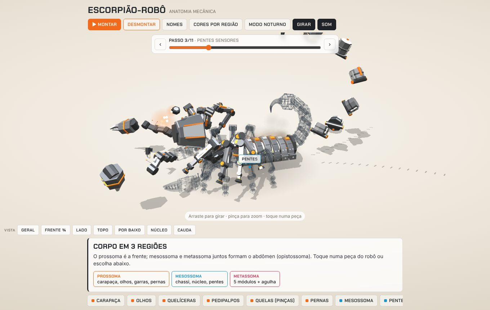

# Escorpião-robô 3D — anatomia mecânica

Modelo 3D interativo que explica a anatomia de um escorpião através de um robô que se monta e desmonta peça por peça. Cada parte mecânica corresponde a uma estrutura real do animal.

**[Abrir a demo](https://kenzokishi.github.io/escorpiao-robo-3d/)**

## O que dá para fazer

- **Montar e desmontar** em 11 passos, com animação das peças voltando ao lugar e uma barra de progresso.
- **Tocar numa peça** para ver o nome e a função dela no animal (carapaça, quelíceras, pedipalpos, pentes, metassoma e outras).
- **Cores por região** (prossoma, mesossoma, metassoma), rótulos, modo noturno, rotação automática e som.
- **Vistas prontas:** geral, frente, lado, topo, por baixo, núcleo e cauda.
- Girar com o mouse ou o dedo e zoom com pinça.

## Como foi feito

Three.js (r128) com a geometria toda montada em código, sem modelo 3D externo. É uma página só, com HTML, CSS e JavaScript.
